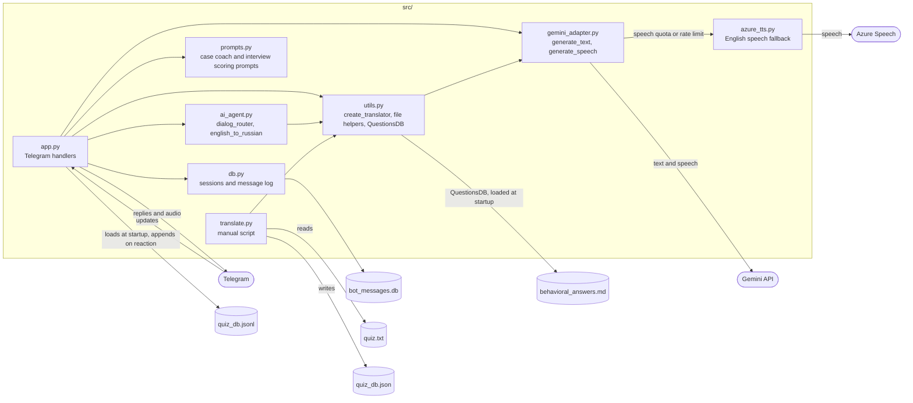
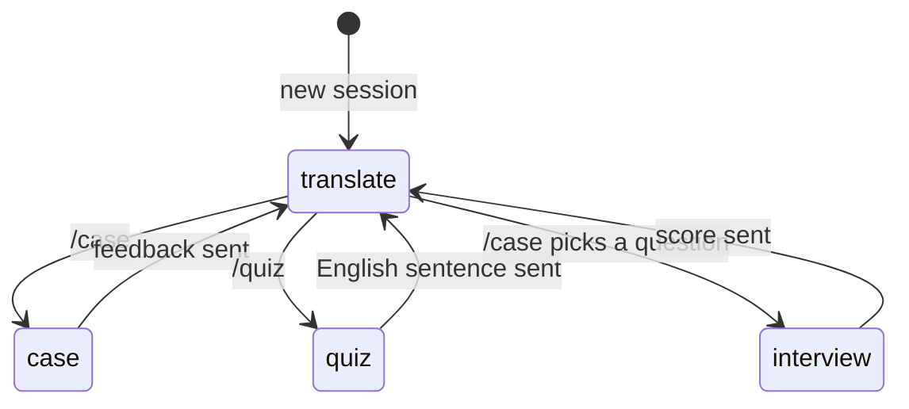

# smoothie_english_bro

A Telegram bot for practicing business English. It:

- fixes the English in short text messages and suggests other ways to say it
- quizzes you on saved phrases: the Russian first, then the English after you reply or send `idk` or `?` (`/quiz`)
- runs a stand-up roleplay and gives feedback on your answer (`/case`)
- asks behavioral interview questions and scores your answers (`/case` picks randomly between the two)
- offers multiple-choice grammar practice from `english_phone_Interview_preparing/units/` (`/grammar`) and shows your score (`/stats`)
- adds any message you react to into the quiz and sends it back as audio

The bot accepts plain-text messages of up to 5,000 characters, including command text, subject to Telegram's own message limits. It warns you about attachments and longer messages without saving or sending them to an AI provider. This limit also applies when reacting to previously saved messages.

Text and speech come from Gemini, with Azure Speech as the fallback when Gemini speech reaches a quota or rate limit. In `english_phone_Interview_preparing/behavioral_answers.md`, each `##` begins an interview question. `### Hint` is the short recall cue shown with the question; `### Ideal answer` is the prepared answer revealed after you respond.

## Setup

The bot runs in Docker. For scripts and checks on your machine, create a Python 3.12 environment, the same version as the image:

```shell
uv venv --python 3.12
source .venv/bin/activate
uv pip install -r requirements.txt
cp env.template .env    # then fill in the values
```

FFmpeg is optional for local speech generation (for example, `brew install ffmpeg` on macOS). It converts Gemini audio to MP3; Gemini handles pacing. The Docker image includes it.

Settings in `.env`:

| Variable | Used for |
|---|---|
| `TG_BOT_TOKEN` | The bot's Telegram token. Required. |
| `GEMINI_API_KEY` | All Gemini calls. Required. |
| `GEMINI_MODEL` | Optional text model, default `gemini-2.0-flash`. |
| `GEMINI_TTS_MODEL` | Optional speech model, default `gemini-2.5-flash-preview-tts`. |
| `AZURE_SPEECH_KEY` | Azure Speech resource key, needed only for speech fallback. |
| `AZURE_SPEECH_REGION` | Region of the same Azure Speech resource (for example, `uksouth`). |
| `SSH_KEY`, `DEPLOY_USERNAME`, `PROD_HOST` | `make deploy` and the other server targets. They aren't in `env.template`, so add them yourself. |
| `OPENAI_API_KEY` | Listed in `env.template`, but not used by the code. |

The Makefile reads `.env`, so every `make` command needs the file, even `make build`.

To show the commands in Telegram's `/` menu, set them in BotFather: `start`, `help`, `quiz`, `case`.

## Run locally

```shell
make prepare-dirs             # once: creates data/tmp, which becomes /tmp in the container
make build                    # after changing requirements.txt or the Dockerfile
make run                      # starts the bot in the background, or restarts it
docker logs -f smoothie_bot   # follow the bot's output
make stop
```

`make run` mounts `src/` and `english_phone_Interview_preparing/` into the container. After editing code or questions, run `make run` again; no rebuild needed. Started directly with `python src/app.py`, the bot fails because of its hardcoded database path (see Data and services below).

Use a separate bot token for local runs. Two copies of the bot polling the same token conflict with each other.

`.dockerignore` keeps `.venv`, `.env`, `.git` and `data` out of the image.

Other targets:

- `make run-debug`: the correction prompt as a console loop (`src/ai_agent.py`), in the container.
- `make run-python`: a Python shell in the container.
- `make run-translate`: runs `src/translate.py` in the container.
- `make chat`: a text-to-speech loop on your machine (`src/gemini_adapter.py`). Activate the venv first. Each line you type is saved as an audio file in the current folder.

## Deploy

```shell
make push-ui          # build the image and push it to Docker Hub as adzhumurat/english_bro:latest
make deploy           # copy src/, english_phone_Interview_preparing/, requirements.txt and the Makefile
make deploy-secrets   # first time, and whenever .env changes: copy .env and the Makefile
make connect          # open a shell on the server, in the project folder
```

Files go to `/home/$DEPLOY_USERNAME/tg_smoothie_english_bot/` on `PROD_HOST`. On a new server, run `make deploy` before `make deploy-secrets`: `deploy` creates the folder, while `scp` in `deploy-secrets` would create a file with the folder's name instead.

Then, on the server:

```shell
docker pull adzhumurat/english_bro:latest   # only after pushing a new image
make run
```

The server doesn't get the Dockerfile, so it runs the image from Docker Hub. `docker run` only downloads the image when the server doesn't have it yet, which is why you pull after each push.

> **Careful:** `make deploy` overwrites the server's `src/quiz_db.jsonl` with your local copy, so phrases the bot added there from reactions are lost unless you copied them back first. If you've run the bot locally, it also overwrites the server's `src/bot_messages.db`.

To diagnose missing narration, run `docker logs --since 10m -f smoothie_bot` on the server, then tap **Narration** and send a short sentence. Look for `narration_mode_set`, `text_routed` (`mode=narration`), and `narration_delivered`. Failures identify the synthesis or Telegram delivery stage without logging the text. The button and follow-up text have different update IDs but should show the same session ID.

`telegram_message_received` logs each incoming message's chat type, character counts, formatting types, and attachment type—not the text, caption, or file name. `input_rejected` distinguishes attachments from oversized text. The startup event `telegram_group_privacy` reports the bot's privacy setting. If a group follow-up has no `telegram_message_received` event, Telegram may not have delivered it; try replying directly to the bot's prompt or testing in a private chat.

After tapping **Narration**, you can send either ordinary text or a Telegram Rich Message. The bot logs `message_type=rich_message` before routing, extracts readable text from headings, paragraphs, lists and other text blocks, and applies the same 5,000-character limit. Rich Messages with embedded media are rejected without downloading the media or sending text to a speech provider.

## How the bot works

`src/app.py` is the entry point. It registers the Telegram handlers, and the handlers call the other modules in `src/`.



### Telegram commands

| What you send | Handler in `app.py` | What happens |
|---|---|---|
| `/start` | `start` | Replies "Choose:" and shows a persistent reply keyboard at the bottom of the chat with two keys, **quiz** and **case**. |
| `/help` | `help_command` | Replies with a one-line hint. |
| `/quiz` | `quiz_command` | Picks a random pair from `quiz_db.jsonl`, sends the Russian sentence, and reveals the English after you try a translation or reply with `idk` or `?`. |
| `/case` | `case_command` | Flips a coin. Case: asks Gemini to open a stand-up roleplay, using the coach prompt and a random scenario from `prompts.py`. Interview: sends a random question from `behavioral_answers.md` and waits — your next message goes to `score_interview_answer`, which has Gemini score it with the interview prompt from `prompts.py` and compare it with your notes for that question. Questions don't repeat until you've had them all, or until the bot restarts. Either way the reply is converted to Telegram HTML and sent in parts of up to 4096 characters. |
| Any other text | `bot_dialog` | Saves your message, then answers based on the session state (see below). |
| A reaction on a message | `handle_reaction` | Translates the message to Russian, saves the pair to the quiz, and sends a voice clip. If translation hits a Gemini limit, the phrase isn't saved, but the bot still tries to send the clip. |

The keyboard keys and the plain words `quiz` and `case` both arrive as text and go through `bot_dialog`, which routes them to the command handlers.

Reactions only work on messages saved in the database: your texts and the bot's quiz, case, interview and correction replies. The bot doesn't save its `/start` and `/help` replies or the voice clips.

### Session state

Each user has a session in SQLite. It lasts one hour from when it was created, except when a quiz answer is still pending. After it expires, the next message starts a new session in the `translate` state. The state decides what `bot_dialog` does with plain text:

- `translate` (default): `ai_agent.dialog_router` sends your text to Gemini, which fixes it and suggests rephrasings. Each line of the answer is sent as its own message, so you can react to one sentence to add it to the quiz.
After your answer, both branches send the feedback or score first, then a 💡 ideal answer. The interview branch uses only the `### Ideal answer` subsection as its scoring reference and then reveals it without the hint. For a stand-up case the ideal answer is generated by Gemini with the ideal-answer prompt from `prompts.py`.

Reply with `idk` or `?` to skip feedback and go straight to the ideal answer. Prepared interview answers need no Gemini call; generated stand-up cases use Gemini only to write the ideal answer.

- `case`: your answer, with the bot's previous message as context, goes to Gemini with the coach prompt. The bot sends feedback, then a Gemini-generated ideal answer, and switches back to `translate`, so each case gets one answer.
- `interview`: set when `/case` picks an interview question. Your next message is scored as the answer to the question. The bot sends the score and feedback, then your prepared notes as the ideal answer, and switches back to `translate`. The question's id is stored in the session, so the answer still gets scored after a bot restart.
- `quiz`: waits for your translation or a skip (`idk` or `?`), then reveals the saved English answer and switches back to `translate`. There is no timer.

Every command also works from the other states. The diagram shows each one starting from `translate`.



### Data and services

- `bot_messages.db` (SQLite, `db.py`) holds the `messages` log, used for reactions and case history, and `sessions`, which stores each user's state and the interview question waiting for an answer. The `reactions` and `translations` tables are created but never written. The path is hardcoded to `/srv/src/bot_messages.db`, which `make run` maps to `src/` on the host. Outside the container that folder usually doesn't exist, so the bot fails at startup.
- `quiz_db.jsonl` holds the quiz pairs as `{"id", "eng", "rus"}` and is loaded once at startup.
- `grammar_attempts` in `bot_messages.db` stores each graded grammar answer. `/stats` totals attempts, correct answers, and accuracy for the current Telegram user. You can also practice locally with `python src/quiz.py`.
- `gemini_adapter.py` talks to Gemini. `generate_text` handles corrections, translations, the case coach and interview scoring, with the model from `GEMINI_MODEL` (default `gemini-2.0-flash`). `generate_speech` uses `GEMINI_TTS_MODEL` (default `gemini-2.5-flash-preview-tts`) and prompts Gemini to read at about 70% of its normal pace. The actual pace can vary. FFmpeg, when available, encodes the clip as MP3 without changing its pace. Both use `GEMINI_API_KEY`, and the bot also needs `TG_BOT_TOKEN`.
- `azure_tts.py` generates MP3 clips only when Gemini speech reports a quota or rate limit. It supports English voices only and defaults to British English with the Sonia female voice at 0.7× speed. Azure does not replace Gemini for text or translation.
- `translate.py` is a manual script, not part of the bot. It translates new lines from `quiz.txt` into `quiz_db.json`. The bot doesn't read that file; it uses `quiz_db.jsonl`.
- `utils.QuestionsDB` loads `english_phone_Interview_preparing/behavioral_answers.md` at startup for the interview half of `/case`, one question per `##` heading. If the file is missing, the bot still starts, and `/case` always gives a stand-up case instead.
